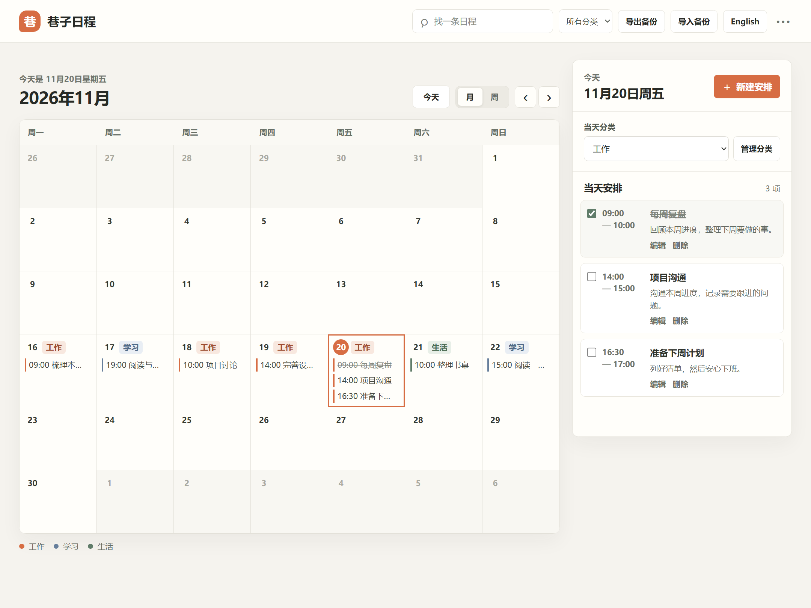
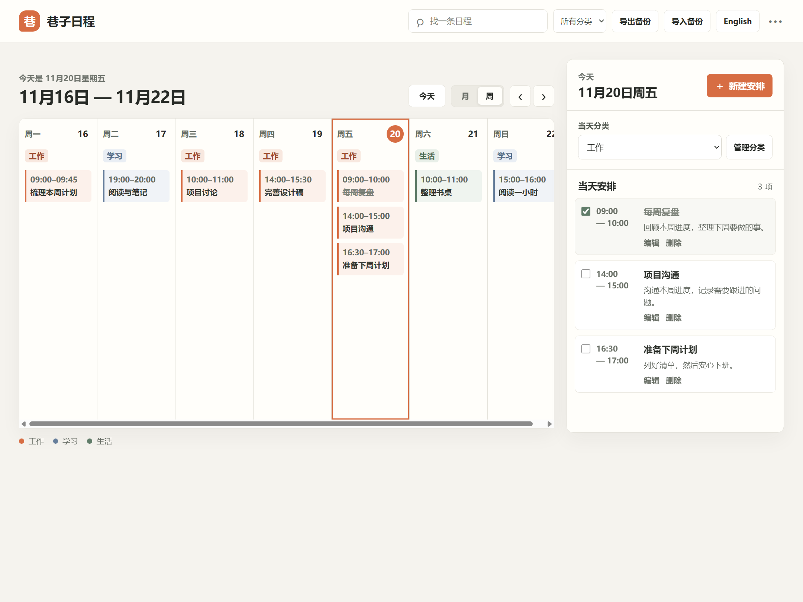
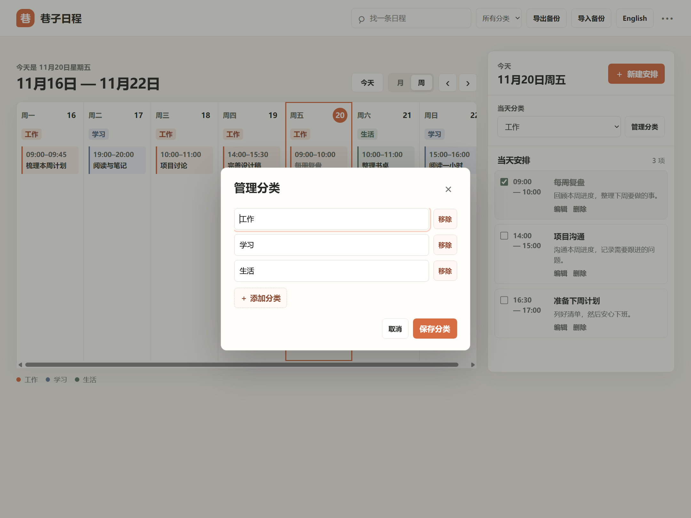
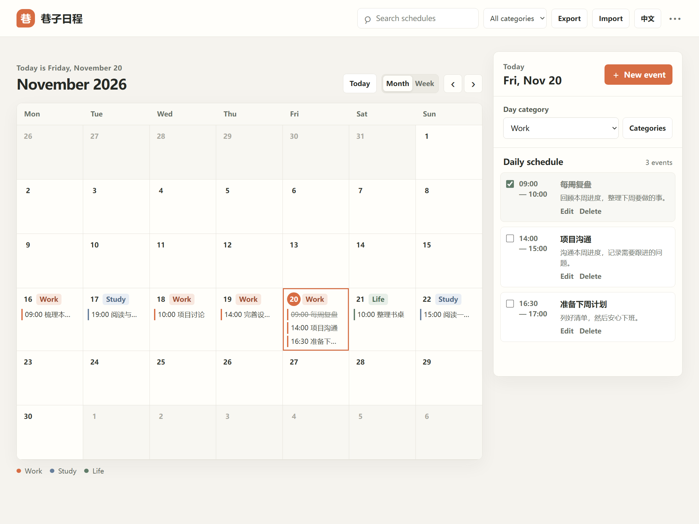

# 巷子日程

一款适用于 Windows 的个人日程桌面应用。用月历看全局，用周历安排一周；按天整理分类，把时间、备注和待办放在一起。

**离线使用 · 自定义分类 · 中文 / English · 无需账号**

[下载 Windows 通用版](https://github.com/3Jackie/xiangzi-schedule/releases/latest) · [查看更新记录](CHANGELOG.md)



## 能做什么

- **月历与周历**：按天查看安排，快速回到今天，切换月份和周。
- **自定义分类**：默认工作、学习、生活，支持增加、改名和移除分类。每个日期选择一个分类，当天安排归在该分类下。
- **完整的安排信息**：名称、日期、起止时间、备注、完成状态。
- **重复安排**：支持每天、工作日和每周重复，可设置结束日期。
- **桌面提醒**：可在开始时或提前 5、10、15、30、60 分钟提醒。
- **搜索与筛选**：按名称、备注搜索所有日期的安排，也可按分类筛选。
- **中英文切换**：点击右上角的 `English` / `中文`，界面、日期格式和操作提示一起切换，重启后记住选择。
- **JSON 备份**：主动导出和恢复日程、分类及语言设置。

## 界面预览

### 一周安排

一周的事项按日期展开，右侧显示所选日期的详细安排。



### 按自己的习惯管理分类

分类改名会同步更新已有日期；移除分类只会将对应日期设为未分类，保留其中的日程。



### English interface

Switch between Chinese and English from the toolbar. Your events, notes, and custom category names stay as you entered them.



以上截图均使用虚构的演示安排，不包含真实日程。

## 下载与使用

1. 在 [Releases](https://github.com/3Jackie/xiangzi-schedule/releases/latest) 中下载 `XiangziSchedule-General-0.1.0-Setup.exe`。
2. 安装并打开「巷子日程」，选择日期和当天分类。
3. 点击「新建安排」，填写名称与时间；需要时添加提醒、重复和备注。

支持 Windows 10/11 x64。当前安装包尚未配置代码签名。

提醒需要程序保持运行。关闭窗口后程序会留在系统托盘；从托盘选择退出后，提醒停止。提醒能否显示还取决于 Windows 通知设置。

## 本机数据与备份

应用不需要账号或网络。通用版数据保存在：

```text
%APPDATA%\xiangzi-schedule-general\schedule-data\plans.json
```

可从右上角 `•••` 打开数据文件夹。建议定期导出 JSON 备份，并保存在自己的安全位置。

恢复备份会替换当前日程，确认恢复前程序会保留本机数据副本。安装包和仓库不包含个人日程。

## 从源码运行

需要 Windows、Node.js 22.12 或更高版本和 npm。

```powershell
npm ci
npm run start:general
```

测试和生成安装包：

```powershell
npm test
npm run test:desktop
npm run build:installer:general
```

桌面测试使用独立的临时数据目录。`npm run screenshots` 可重新生成本页的通用版演示截图。

## 许可证

[MIT](LICENSE)
